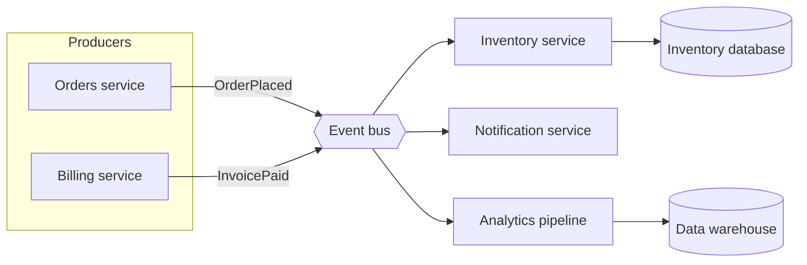

# Event-driven services

Producers publish events to a bus; independent consumers react, so teams can add behaviour without editing the producer.

[Open in Planloom](https://planloom.app/mermaid-to-canvas?src=Zmxvd2NoYXJ0IExSCiAgc3ViZ3JhcGggUHJvZHVjZXJzCiAgICBvcmRlcnNbT3JkZXJzIHNlcnZpY2VdCiAgICBiaWxsaW5nW0JpbGxpbmcgc2VydmljZV0KICBlbmQKICBvcmRlcnMgLS0-fE9yZGVyUGxhY2VkfCBidXN7e0V2ZW50IGJ1c319CiAgYmlsbGluZyAtLT58SW52b2ljZVBhaWR8IGJ1cwogIGJ1cyAtLT4gaW52ZW50b3J5W0ludmVudG9yeSBzZXJ2aWNlXQogIGJ1cyAtLT4gbm90aWZ5W05vdGlmaWNhdGlvbiBzZXJ2aWNlXQogIGJ1cyAtLT4gYW5hbHl0aWNzW0FuYWx5dGljcyBwaXBlbGluZV0KICBpbnZlbnRvcnkgLS0-IGludmRiWyhJbnZlbnRvcnkgZGF0YWJhc2UpXQogIGFuYWx5dGljcyAtLT4gd2FyZWhvdXNlWyhEYXRhIHdhcmVob3VzZSldCg#tool) to edit it on an infinite canvas, no account needed. The source is in [`diagram.mmd`](./diagram.mmd).

## When to use it
- Several teams need to react to the same business events.
- You can tolerate eventual consistency between services.

## Decisions this diagram makes
- Name events in the past tense (OrderPlaced) and treat them as a public contract.
- Consumers must be idempotent: events can be delivered more than once.
- Version events before changing their shape.

## Adapt it
- Replace the bus with Kafka, SNS/SQS, NATS or a database outbox, whichever your team already runs.
- Start with one producer and one consumer; add the rest as real needs appear.
