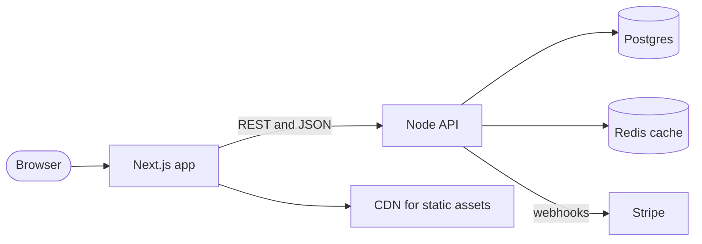

# Next.js + Node API + Postgres

The classic SaaS stack: a Next.js front end, a separate Node API, Postgres for data, Redis for caching, and Stripe webhooks.

[Open in Planloom](https://planloom.app/mermaid-to-canvas?src=Zmxvd2NoYXJ0IExSCiAgdXNlcihbQnJvd3Nlcl0pIC0tPiB3ZWJbTmV4dC5qcyBhcHBdCiAgd2ViIC0tPnxSRVNUIGFuZCBKU09OfCBhcGlbTm9kZSBBUEldCiAgd2ViIC0tPiBjZG5bQ0ROIGZvciBzdGF0aWMgYXNzZXRzXQogIGFwaSAtLT4gZGJbKFBvc3RncmVzKV0KICBhcGkgLS0-IGNhY2hlWyhSZWRpcyBjYWNoZSldCiAgYXBpIC0tPnx3ZWJob29rc3wgc3RyaXBlW1N0cmlwZV0K#tool) to edit it on an infinite canvas, no account needed. The source is in [`diagram.mmd`](./diagram.mmd).

## When to use it
- Early-stage SaaS where one team owns the front end and the API.
- You want a clear boundary between rendering and business logic.

## Decisions this diagram makes
- Keep the API stateless so it scales horizontally; put sessions in Redis or signed tokens.
- Treat Stripe webhooks as an inbound edge: verify signatures and make handlers idempotent.
- Cache reads in Redis, never the source of truth.

## Adapt it
- Swap Redis for your cache of choice, or drop it until you measure a need.
- Add a background worker once any request does slow work (see the React + API + queue example).
