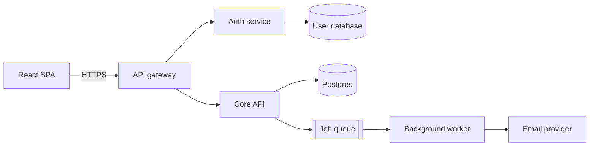

# React SPA + API + background jobs

A single-page app talking to an API gateway, with auth separated from core logic and slow work pushed to a queue.

[Open in Planloom](https://planloom.app/mermaid-to-canvas?src=Zmxvd2NoYXJ0IExSCiAgc3BhW1JlYWN0IFNQQV0gLS0-fEhUVFBTfCBnd1tBUEkgZ2F0ZXdheV0KICBndyAtLT4gYXV0aFtBdXRoIHNlcnZpY2VdCiAgZ3cgLS0-IGNvcmVbQ29yZSBBUEldCiAgYXV0aCAtLT4gdXNlcnNbKFVzZXIgZGF0YWJhc2UpXQogIGNvcmUgLS0-IGRhdGFbKFBvc3RncmVzKV0KICBjb3JlIC0tPiBxdWV1ZVtbSm9iIHF1ZXVlXV0KICBxdWV1ZSAtLT4gd29ya2VyW0JhY2tncm91bmQgd29ya2VyXQogIHdvcmtlciAtLT4gZW1haWxbRW1haWwgcHJvdmlkZXJdCg#tool) to edit it on an infinite canvas, no account needed. The source is in [`diagram.mmd`](./diagram.mmd).

## When to use it
- The product sends email, generates reports or calls slow third parties.
- You want sign-in handled separately from product logic.

## Decisions this diagram makes
- Anything over a second belongs on the queue, not in the request.
- Workers need retries with backoff and a dead-letter path.
- Keep the gateway thin: routing, rate limits and auth checks only.

## Adapt it
- Collapse the gateway and Core API into one service until you have a reason to split.
- Add a read replica or a search index beside the Postgres box when queries get heavy.
