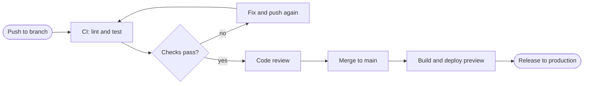

# CI/CD pipeline

Push, test, review, merge, deploy, with the failure loop drawn in.

[Open in Planloom](https://planloom.app/mermaid-to-canvas?src=Zmxvd2NoYXJ0IExSCiAgcHVzaChbUHVzaCB0byBicmFuY2hdKSAtLT4gY2lbQ0k6IGxpbnQgYW5kIHRlc3RdCiAgY2kgLS0-IHBhc3N7Q2hlY2tzIHBhc3M_fQogIHBhc3MgLS0-fG5vfCBmaXhbRml4IGFuZCBwdXNoIGFnYWluXQogIGZpeCAtLT4gY2kKICBwYXNzIC0tPnx5ZXN8IHJldmlld1tDb2RlIHJldmlld10KICByZXZpZXcgLS0-IG1lcmdlW01lcmdlIHRvIG1haW5dCiAgbWVyZ2UgLS0-IGJ1aWxkW0J1aWxkIGFuZCBkZXBsb3kgcHJldmlld10KICBidWlsZCAtLT4gcHJvZChbUmVsZWFzZSB0byBwcm9kdWN0aW9uXSkK#tool) to edit it on an infinite canvas, no account needed. The source is in [`diagram.mmd`](./diagram.mmd).

## When to use it
- You want a shared picture of how change reaches production.

## Decisions this diagram makes
- Fast feedback first: lint and unit tests before slow suites.
- Make the failure loop visible so people know what a red check means.
- Decide who may merge and who may release.

## Adapt it
- Add security scanning, migrations and approval gates as extra nodes.
- Split preview and production deploys into their own lanes.
