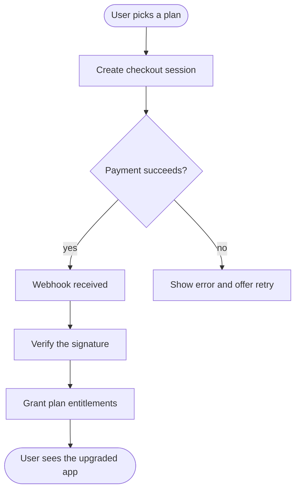

# Subscription checkout and webhook flow

From picking a plan to unlocking features, with the webhook as the source of truth.

[Open in Planloom](https://planloom.app/mermaid-to-canvas?src=Zmxvd2NoYXJ0IFRECiAgc3RhcnQoW1VzZXIgcGlja3MgYSBwbGFuXSkgLS0-IGNoZWNrb3V0W0NyZWF0ZSBjaGVja291dCBzZXNzaW9uXQogIGNoZWNrb3V0IC0tPiBwYXl7UGF5bWVudCBzdWNjZWVkcz99CiAgcGF5IC0tPnx5ZXN8IHdlYmhvb2tbV2ViaG9vayByZWNlaXZlZF0KICBwYXkgLS0-fG5vfCByZXRyeVtTaG93IGVycm9yIGFuZCBvZmZlciByZXRyeV0KICB3ZWJob29rIC0tPiB2ZXJpZnlbVmVyaWZ5IHRoZSBzaWduYXR1cmVdCiAgdmVyaWZ5IC0tPiBncmFudFtHcmFudCBwbGFuIGVudGl0bGVtZW50c10KICBncmFudCAtLT4gZG9uZShbVXNlciBzZWVzIHRoZSB1cGdyYWRlZCBhcHBdKQo#tool) to edit it on an infinite canvas, no account needed. The source is in [`diagram.mmd`](./diagram.mmd).

## When to use it
- You are adding paid plans and want the happy and unhappy paths written down.

## Decisions this diagram makes
- Unlock features from the verified webhook, not from the browser redirect.
- Store the provider event id so retries do not grant twice.
- Decide what happens on failed renewals before you launch.

## Adapt it
- Add trials, proration and cancellation as separate branches.
- Swap Stripe for your billing provider; the shape stays the same.
