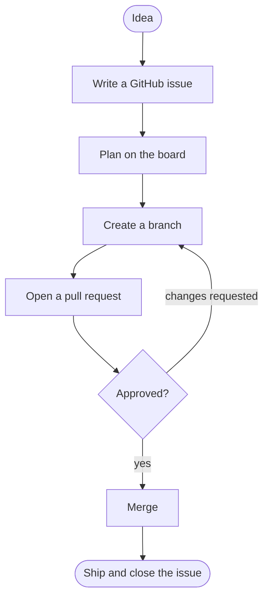

# From idea to shipped

The lifecycle of one piece of work: idea, issue, plan, branch, pull request, review, merge, ship.

[Open in Planloom](https://planloom.app/mermaid-to-canvas?src=Zmxvd2NoYXJ0IFRECiAgaWRlYShbSWRlYV0pIC0tPiBpc3N1ZVtXcml0ZSBhIEdpdEh1YiBpc3N1ZV0KICBpc3N1ZSAtLT4gcGxhbltQbGFuIG9uIHRoZSBib2FyZF0KICBwbGFuIC0tPiBicmFuY2hbQ3JlYXRlIGEgYnJhbmNoXQogIGJyYW5jaCAtLT4gcHJbT3BlbiBhIHB1bGwgcmVxdWVzdF0KICBwciAtLT4gcmV2aWV3e0FwcHJvdmVkP30KICByZXZpZXcgLS0-fGNoYW5nZXMgcmVxdWVzdGVkfCBicmFuY2gKICByZXZpZXcgLS0-fHllc3wgbWVyZ2VbTWVyZ2VdCiAgbWVyZ2UgLS0-IHNoaXAoW1NoaXAgYW5kIGNsb3NlIHRoZSBpc3N1ZV0pCg#tool) to edit it on an infinite canvas, no account needed. The source is in [`diagram.mmd`](./diagram.mmd).

## When to use it
- You want new teammates to see how work moves from thought to production.

## Decisions this diagram makes
- The plan lives before the issue, so tickets stay small and agreed.
- Link the pull request to the issue so closing is automatic.
- Keep review loops short: small pull requests, clear owners.

## Adapt it
- Add design review, QA or feature-flag steps.
- Draw your real branch naming and release cadence on top.
