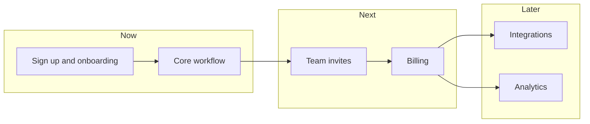

# MVP roadmap: now, next, later

A thin end-to-end first release, with what comes after grouped by horizon.

[Open in Planloom](https://planloom.app/mermaid-to-canvas?src=Zmxvd2NoYXJ0IExSCiAgc3ViZ3JhcGggTm93CiAgICBhW1NpZ24gdXAgYW5kIG9uYm9hcmRpbmddCiAgICBiW0NvcmUgd29ya2Zsb3ddCiAgZW5kCiAgc3ViZ3JhcGggTmV4dAogICAgY1tUZWFtIGludml0ZXNdCiAgICBkW0JpbGxpbmddCiAgZW5kCiAgc3ViZ3JhcGggTGF0ZXIKICAgIGVbSW50ZWdyYXRpb25zXQogICAgZltBbmFseXRpY3NdCiAgZW5kCiAgYSAtLT4gYgogIGIgLS0-IGMKICBjIC0tPiBkCiAgZCAtLT4gZQogIGQgLS0-IGYK#tool) to edit it on an infinite canvas, no account needed. The source is in [`diagram.mmd`](./diagram.mmd).

## When to use it
- You need to cut scope for a first release and show what is deliberately not in it.

## Decisions this diagram makes
- The MVP is the thinnest path a user can complete end to end, not a feature list.
- Arrows show dependencies, so you can see what unblocks what.
- Revisit the horizons after every release.

## Adapt it
- Rename the horizons to dates or quarters.
- Turn each box into a task and link it back to this map.
