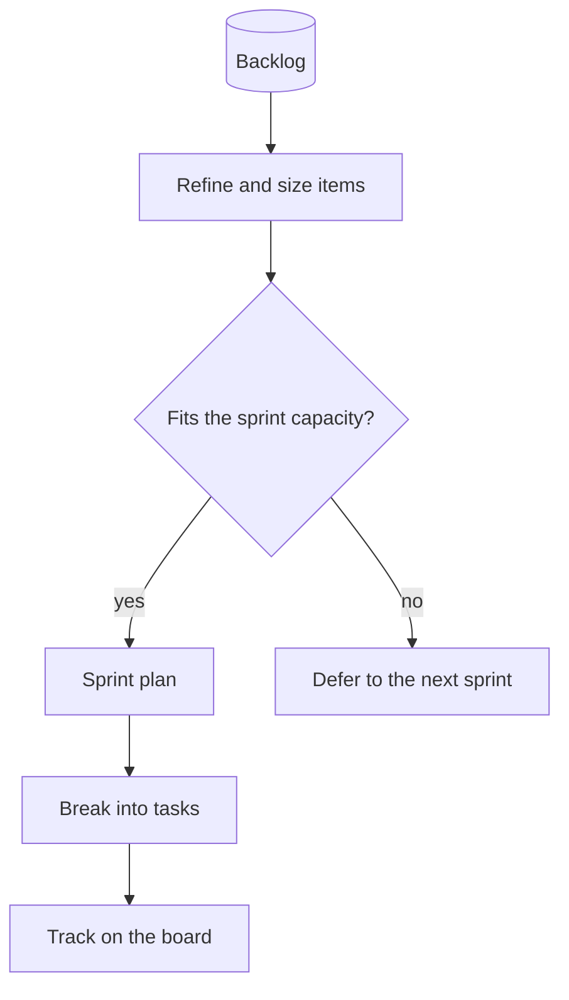

# Sprint planning

Backlog to board: refine, check capacity, plan, break into tasks.

[Open in Planloom](https://planloom.app/mermaid-to-canvas?src=Zmxvd2NoYXJ0IFRECiAgYmFja2xvZ1soQmFja2xvZyldIC0tPiByZWZpbmVbUmVmaW5lIGFuZCBzaXplIGl0ZW1zXQogIHJlZmluZSAtLT4gcGlja3tGaXRzIHRoZSBzcHJpbnQgY2FwYWNpdHk_fQogIHBpY2sgLS0-fHllc3wgc3ByaW50W1NwcmludCBwbGFuXQogIHBpY2sgLS0-fG5vfCBkZWZlcltEZWZlciB0byB0aGUgbmV4dCBzcHJpbnRdCiAgc3ByaW50IC0tPiB0YXNrc1tCcmVhayBpbnRvIHRhc2tzXQogIHRhc2tzIC0tPiBib2FyZFtUcmFjayBvbiB0aGUgYm9hcmRdCg#tool) to edit it on an infinite canvas, no account needed. The source is in [`diagram.mmd`](./diagram.mmd).

## When to use it
- You run sprints and want planning to be a visible, repeatable flow.

## Decisions this diagram makes
- Size before you commit; capacity is a decision, not a hope.
- Break work into tasks small enough to finish in a day or two.
- Keep a visible place for deferred items so they do not vanish.

## Adapt it
- Add a retrospective loop back to the backlog.
- Link each task to its pull request when work starts.
